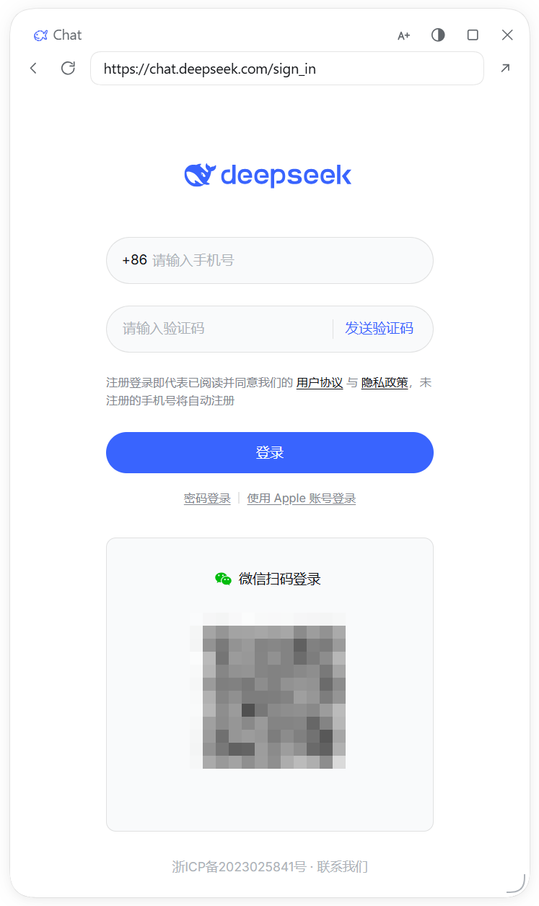

# Chat in Harness

> 中文版见 [README.md](README.md)

`chat.deepseek.com` in a floating window that survives conversation switches. The plugin takes a browser lease from DSH, creates a `<webview>` and navigates it to the official page — everything inside is the site's own code, running as usual.



## What it does not do

This section matters more than the one above.

| Not | Why |
|---|---|
| No API calls | Never touches `/api/v0/*`; builds no requests, parses no responses |
| No credential storage | Never reads cookies or localStorage, no snapshots, no login replay; only window layout lives in DSH's own localStorage |
| No script injection | Never injects or executes anything in the page |
| No fingerprint spoofing | Only strips `Electron/x.y.z` from the UA |
| No bulk operations | No concurrency, queues or retries |

The UA change is the only exception: without it the site flags the Electron container as abnormal.

## Features

- Two-row header: title (whale + Chat / zoom / opacity / maximize / hide) and navigation (back / forward / reload / address / open in browser)
- Drag, resize, remember position, edge snapping; double-click the title bar or press the button to maximize
- `×` hides the window: collapses into the floating ball when enabled, otherwise disappears
- Chat capsule in the sidebar footer; a settings page with two toggles, a status card and a reset button
- `/chat` opens the window from the composer — no message sent, no model call spent
- UI language follows DSH; anything but Chinese shows English

## Install

Follow the default branch:

```powershell
dsh plugin --profile desktop add https://github.com/qcann/dsh-chat-in-harness
```

Or the prebuilt release package (`latest` points at the newest release):

```powershell
dsh plugin --profile desktop add https://github.com/qcann/dsh-chat-in-harness/releases/latest/download/dsh-chat-in-harness.tgz
```

Restart DSH afterwards. Requires DSH ≥ 0.2.1-rc.1 and Node ≥ 20.

## Known limits

- **Desktop only.** The web build has no `<webview>` host.
- **Platform.** Tested on Windows only; macOS and Linux are unverified. No platform-specific APIs are used (no `node:` modules, no filesystem access), but identical behavior is not promised.
- **Restart signs you out.** The lease is an in-memory partition, so cookies are not persisted — DSH's behavior, not ours. For the same reason there is no logout button: use the site's own sign-out, or restart.
- **DSH shortcuts and Esc do nothing while the page has focus.** Keys belong to the page; the plugin injects no scripts and cannot intercept keyboard events in the webview. Esc closes the window only from the title bar or border.
- **Layering.** `z-index: 60`: menus (100) and modals (1000) cover it. It shares a layer with DSH's own floating panel and paints above it by DOM order.
- **Link allowlist.** Only `deepseek.com` and its subdomains stay in the guest; everything else opens in the system browser.
- **In-page "Copy" buttons fail.** DSH denies clipboard permissions to guests. Select and press `Ctrl+C` (`Cmd+C` on macOS) — the native path works.

## Risk notice

- Unofficial project, not affiliated with DeepSeek. The icon is an original drawing, not the official mark.
- No proxying, forwarding or data storage. Whether a third-party container complies with the site's terms is your call.
- Rate limits, site changes and DSH upgrades can break it. Use at your own risk.

## Philosophy: restraint

Ten things are possible; do three. Every feature answers "what breaks without it"; nothing sits between the user and the site; errors appear where the user can see them; delete before adding.
