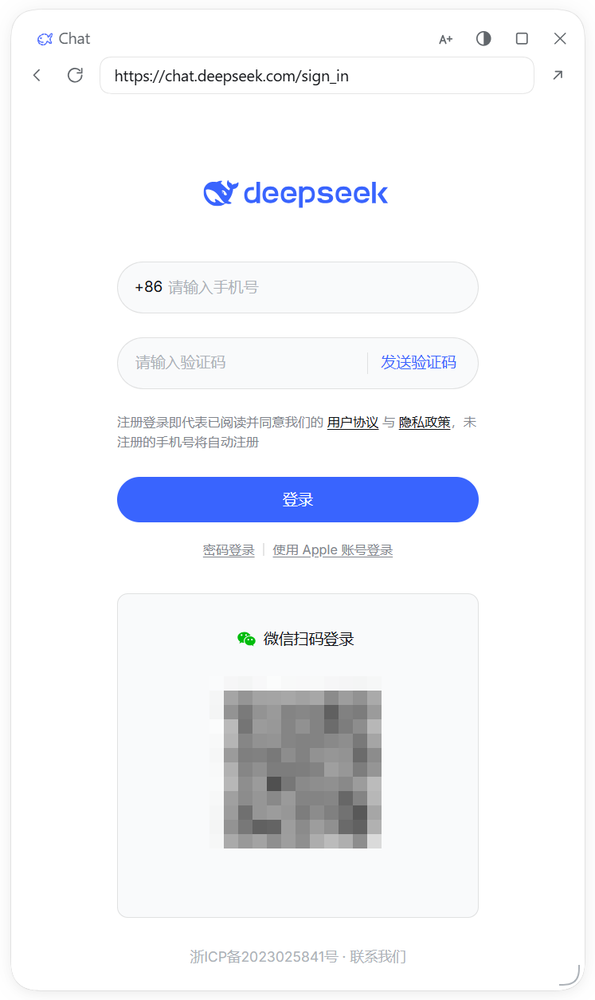

# Chat in Harness

> English version: [README.en.md](README.en.md)

把 `chat.deepseek.com` 装进一个与会话无关的浮窗。向 DSH 要一份浏览器租约，创建 `<webview>`，导航到官网——页面里的一切都交给官网自己跑。



## 它不做什么

这一节比上面重要。

| 不做 | 说明 |
|---|---|
| 不调接口 | 不碰 `/api/v0/*`，不构造请求，不解析响应 |
| 不存凭据 | 不读 cookie / localStorage，不快照、不重放登录态；只在 DSH 自己的 localStorage 记窗口布局 |
| 不注入脚本 | 一次都不注入，也不执行脚本 |
| 不改指纹 | 只从 UA 去掉 `Electron/x.y.z` |
| 不批量操作 | 没有并发、队列、重试 |

UA 那处是唯一的例外：不去掉的话，官网会把 Electron 容器判成「环境异常」。

## 功能

- 两行头部：标题（鲸鱼 + Chat / 缩放 / 不透明度 / 铺满 / 收起）、导航（后退 / 前进 / 刷新 / 地址 / 系统浏览器）
- 拖动、缩放、位置记忆、边缘吸附；双击标题栏或点按钮切换铺满
- `×` 收起：开了悬浮球就收成球，否则隐藏
- 左下角 Chat 胶囊；设置页两个开关、状态卡、重置窗口
- `/chat`：在输入框敲一下就打开浮窗，不发消息、不消耗模型调用
- 界面语言跟随 DSH，中文以外的语言显示英文

## 安装

跟随默认分支：

```powershell
dsh plugin --profile desktop add https://github.com/qcann/dsh-chat-in-harness
```

或用 Release 的预构建包（`latest` 指向最新版）：

```powershell
dsh plugin --profile desktop add https://github.com/qcann/dsh-chat-in-harness/releases/latest/download/dsh-chat-in-harness.tgz
```

装完重启 DSH。要求 DSH ≥ 0.2.1-rc.1、Node ≥ 20。

## 已知边界

- **仅桌面端**：Web 版没有 `<webview>` 宿主。
- **平台**：只在 Windows 实测；macOS / Linux 未验证。代码没有平台特定 API（无 `node:` 模块、无文件访问），但不承诺行为一致。
- **重启即登出**：租约是内存分区，cookie 不落盘——这是 DSH 的行为。同理，插件没有「退出登录」按钮，换账号用官网自己的入口或重启。
- **焦点在网页里时，DSH 快捷键与 Esc 都不生效**：按键归页面；我们不注入脚本，也拦不到 webview 内的键盘事件。Esc 只在焦点位于标题栏或边框时收起浮窗。
- **层级**：`z-index: 60`，会被菜单（100）和模态框（1000）盖住；与 DSH 自己的浮窗同层，靠 DOM 顺序压在其上。
- **链接白名单**：只放行 `deepseek.com` 及其子域，其余交给系统浏览器。
- **网页里的「复制」按钮不可用**：DSH 拒绝 guest 的剪贴板权限。选中后按 `Ctrl+C`（macOS `Cmd+C`）正常，走原生复制。

## 风险声明

- 非官方项目，与 DeepSeek 无关联；图标为自绘虚线鲸鱼，未使用官方标识。
- 不代理、不转发、不存储数据；用第三方容器访问站点是否符合条款，请自行确认。
- 限流、改版、DSH 升级都可能影响可用性，风险自负。

## 理念：克制

能做到十件事，只做三件。每个功能先回答「不做会怎样」；不在用户和官网之间加一层；错误显示在用户看得见的地方；先删后加。
